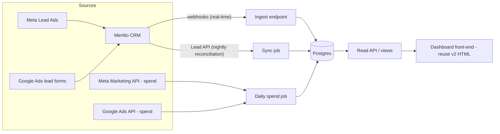

# PrepQ Lead Dashboard — Developer Handoff Brief

**Prepared for:** the developer building the live version
**Owner:** Emil (agency side)
**Status:** demo approved, ready to build against real data

---

## 1. What we're building and why

PrepQ is an education client (two courses: **CPA** and **EA**). We run **Meta and Google lead-gen ads** for them. Leads flow into **Meritto CRM** (formerly NoPaperForms), where the client's sales team calls them, marks dispositions, runs demo sessions, and closes enrolments.

We need a **live reporting dashboard** that the agency team, the sales team, and the PrepQ founders open every morning. A fully working interactive demo with simulated data already exists and is the visual + functional spec:

- **Demo (build this):** [PrepQ · Lead Performance v2](https://claude.ai/code/artifact/827f8cf2-d658-4f2a-b4d0-b45e6c02c06e)
- Earlier simpler version, for reference: [v1](https://claude.ai/code/artifact/8fcf2e79-33f9-49d2-b4b8-e4d0bddc38c6)

The v2 demo's HTML file accompanies this brief. **The front-end can be reused nearly as-is** — it is a single self-contained HTML file (no framework, no external libs, plain SVG charts, light/dark theming). All rendering reads from one in-memory array of lead objects (`leads[]`) plus two constant maps (`TARGETS`, `FEES`). Your job on the front-end is essentially: delete the simulated-data generator (the top of the `<script>`), fetch real rows from the backend into the same shape, and keep everything else.

Longer term this becomes a multi-client product, so keep client-specific things (targets, fees, statuses, branding) in config/data, not code.

---

## 2. Target architecture



**Principles**

1. **Meritto stays the source of truth.** The sales team never touches our system; we mirror Meritto. Never write lead data back.
2. **Ingest is event-driven, reconciliation is scheduled.** Webhooks give real-time freshness; a nightly Lead API pull heals missed events.
3. **Store raw events, derive everything else.** Metrics are computed in SQL views / API layer, not hand-maintained.

**Suggested stack** (opinionated, swap freely): Supabase (Postgres + auth + row-level security) or plain Postgres on any host; ingest + jobs as serverless functions or a small Node service; front-end as the existing HTML served from Vercel/Netlify behind auth. n8n or Make is acceptable for the spend jobs if you'd rather not write API clients.

---

## 3. Data model

```sql
-- One row per lead, mirrored from Meritto
create table leads (
  id               text primary key,        -- Meritto lead id
  created_at       timestamptz not null,    -- lead creation in Meritto
  course           text not null,           -- 'CPA' | 'EA'  (from form/program field)
  source           text not null,           -- 'Meta' | 'Google' | 'Organic' | ...
  campaign         text,                    -- utm_campaign / Meritto source detail
  ad_set           text,
  creative         text,                    -- utm_content / ad name  → "campaign table" rows
  owner            text,                    -- salesperson assigned
  first_call_at    timestamptz,             -- earliest call activity (from activity log)
  call_attempts    int not null default 0,
  connect_attempt  int,                     -- which attempt connected (null = never)
  connected        boolean not null default false,
  status           text not null,           -- see mapping §5
  dq_reason        text,                    -- when status = 'not_qualified'
  demo_booked_at   timestamptz,
  demo_attended_at timestamptz,
  enrolled_at      timestamptz,             -- ideally from Meritto payment stage
  fee_paid         numeric,                 -- actual amount if available
  raw              jsonb,                   -- last full Meritto payload, for audit
  updated_at       timestamptz not null
);

-- Raw webhook events, append-only (audit + replay)
create table meritto_events (
  id          bigserial primary key,
  received_at timestamptz not null default now(),
  event_type  text,
  lead_id     text,
  payload     jsonb not null
);

-- Daily ad spend per campaign
create table spend (
  date       date not null,
  source     text not null,                 -- 'Meta' | 'Google'
  campaign   text not null,
  ad_set     text,
  spend      numeric not null,
  impressions bigint,
  clicks     bigint,
  primary key (date, source, campaign, ad_set)
);

-- Client-configured numbers (keep out of code)
create table targets (
  month        date not null,               -- first of month
  course       text not null,
  lead_target  int not null,
  primary key (month, course)
);

create table course_fees (
  course text primary key,
  fee    numeric not null                   -- used when fee_paid is null
);
```

---

## 4. Integrations

### 4.1 Meritto → us (the core one)

Meritto exposes both push and pull ([developer portal](https://www.meritto.com/developer-portal/)):

- **Webhook Manager** — configure lead-level triggers (lead created, stage/disposition changed) posting JSON to our ingest endpoint. Docs: [webhook configuration](https://support.meritto.com/hc/en-us/articles/10243901752473-ERP-CONNECT-Webhook-Integration-Configuration-Steps). There is also [bulk webhook push](https://support.meritto.com/hc/en-us/articles/32584264893081-Bulk-Webhook-Push) for backfilling/replaying missed events — use it for the initial historical load if the Lead API export is awkward.
- **Lead API** — read lead metadata **and activity data** (the activity log is where call attempts and their timestamps come from → `first_call_at`, `call_attempts`, `connect_attempt`).
- **Payments API** — if PrepQ collects fees through Meritto, derive `enrolled_at` / `fee_paid` from payment records instead of a sales-entered stage. Strongly preferred: revenue numbers stop being self-reported.

**Ingest endpoint requirements**

- Append every payload to `meritto_events`, then **upsert** into `leads` keyed by Meritto lead id. Idempotent — webhooks will re-deliver.
- Verify a shared secret/token on the endpoint (whatever Meritto's webhook config supports).
- **Nightly reconciliation job:** pull leads modified in the last N days via the Lead API, diff against `leads`, upsert. This heals missed webhooks and fills activity-derived fields if they don't arrive via webhook payloads.

**Unknowns to resolve first week** (ask Meritto's account manager — API/webhook availability can be plan-gated):

1. API credentials + docs access for PrepQ's account.
2. Exact webhook payload fields — especially whether activity (call) data is in the payload or only via the Lead API.
3. Whether Meta/Google campaign/ad-set/creative attribution is captured on the lead record today (see §5, item 1 — blocking).

### 4.2 Ad spend

- **Google Ads API**: daily job pulling cost per campaign/ad group. (If the dashboard were Looker Studio this would be a free native connector; for our custom front-end, a scheduled API pull into `spend`.)
- **Meta Marketing API**: daily insights pull (`spend`, `impressions`, campaign/adset/ad names) into `spend`.
- Join key between `spend` and `leads` is `(source, campaign)` — which only works if naming/UTM discipline holds (§5).
- Acceptable v1 shortcut: a manually-maintained spend sheet imported daily, swapped for API pulls later.

---

## 5. Meritto configuration prerequisites (blocking — verify before building)

1. **Attribution on every lead.** The native Meta and Google lead integrations into Meritto must capture campaign / ad set / creative (or UTMs) onto the lead record. Without this the campaign table and CPL-by-creative cannot exist, and it **cannot be backfilled**. Verify on a real lead before writing any code.
2. **Standardized dispositions.** Meritto stages/dispositions must map cleanly to the dashboard statuses:

| Dashboard status | Meaning |
|---|---|
| `uncalled` | zero call attempts |
| `not_reachable` | attempted, never connected, < 4 attempts (still in follow-up window) |
| `junk` | 4 attempts exhausted, or invalid number |
| `not_qualified` | connected, disqualified — **requires `dq_reason`** |
| `qualified` | connected, qualified |

   `dq_reason` dropdown (not free text): *Can't afford / Not eligible / Just researching / Wrong expectations / Timing — next intake*.
3. **Demo stages exist**: demo booked, demo attended must be recorded stages/fields in Meritto.
4. **Enrolment definition**: payment received (Payments API) if at all possible.

Free-text dispositions are the failure mode that kills this project — get the dropdowns locked in Meritto before go-live.

---

## 6. Metric definitions (implement exactly — the demo is the reference)

All range-filtered metrics respect the global filters: date range (last 7 / last 30 / MTD / QTD), course, source. Exceptions noted.

- **Leads**: count of `leads` with `created_at` in range.
- **Qualified rate**: `status = 'qualified'` / leads. **Junk rate**: `status = 'junk'` / leads.
- **Enrolled**: `enrolled_at` not null (lead counted in its `created_at` range — see cohort note).
- **Speed to lead**: `first_call_at − created_at`. Report median, plus connect-rate by bucket: `<1h`, `1–4h`, `4–24h`, `>24h`.
- **Uncalled aging** (ignores date-range filter — it's a live queue): `call_attempts = 0`, bucketed by age: `<24h`, `24–48h`, `>48h`; per-owner backlog callout.
- **Follow-up depth**: distribution of `connect_attempt` (1–4) among called leads, plus never-connected.
- **Funnel**: leads → `connected` → `qualified` → `demo_booked_at` → `demo_attended_at` → `enrolled_at`, each as % of total and % of previous stage.
- **Target pacing** (always current-month, ignores range filter): MTD leads per course vs `targets.lead_target × (day_of_month / days_in_month)`; show ahead/behind and required run-rate `(target − actual) / days_remaining`.
- **CPL**: spend in range / leads. **Cost per qualified**: spend / qualified. **Cost per enrolment**: spend / enrolled.
- **Return on spend**: `Σ fee (fee_paid, else course_fees.fee) for enrolled leads / Σ spend`, per course and blended.
- **Cohort conversion** (ignores date-range filter): group by `month(created_at)`; enrolled-so-far %, labeled matured / mostly matured / still maturing.
- **Creative fatigue**: per campaign, qualified-rate over trailing 14 days vs the 14 before; `|Δ| < 3pp` = steady, else ▲/▼ with pp change; suppress when either window has < 10 leads.
- **Arrival heatmap**: lead counts by day-of-week × 3-hour block (6–24h) of `created_at`, tooltip = connect rate of that cell.
- **Period-over-period delta**: leads in range vs the immediately preceding equal-length period.

---

## 7. Front-end plan

- Reuse `prepq-dashboard-v2.html` (attached). Replace the data generator with a fetch of lead rows + spend + targets from the read API into the same field names used by the render functions; everything else (filters, charts, theming) already works.
- Serve behind simple auth (e.g. Google sign-in restricted to the agency + PrepQ domains). Read-only for everyone.
- Auto-refresh on load is sufficient; no live websockets needed for a morning dashboard.
- Keep the palette/CSS variables as-is — they're accessibility-validated (colorblind-safe ordering, light/dark modes).
- Note: the demo is hosted as a Claude artifact, which cannot fetch external data by design — the live version must be hosted on our own infra (Vercel/Netlify/Apps Script — anywhere).

---

## 8. Build phases

| Phase | Scope | Definition of done |
|---|---|---|
| **0. Discovery** (blocking) | Meritto API creds, webhook payload samples, attribution check on a real lead, disposition cleanup agreed | We have a real lead JSON showing campaign attribution + activity log |
| **1. Pipeline** | DB schema, ingest endpoint, webhook config in Meritto, historical backfill, nightly reconciliation | `leads` table matches Meritto counts for the trailing 90 days |
| **2. Spend** | Meta + Google daily spend jobs (or manual sheet import v1) | `spend` populated daily by 8:00 IST |
| **3. Dashboard** | Wire v2 front-end to read API, auth, deploy | Team opens one URL each morning; numbers match Meritto spot-checks |
| **4. Hardening** | Alerting on pipeline failure, event replay runbook, targets admin | A missed webhook day self-heals; non-devs can update monthly targets |

Future (post-PrepQ): multi-tenant — `client_id` on every table, per-client config (courses→products, statuses, fees, branding). Design the schema with that column from day one even if it's constant.

---

## 9. Access checklist (Emil to provide)

- [ ] Meritto admin access / account-manager contact; API credentials
- [ ] Meta Business Manager access to the ad account (for Marketing API token)
- [ ] Google Ads account access (developer token / OAuth)
- [ ] Confirmed monthly lead targets per course (currently CPA 600 / EA 400 in the demo — confirm with client)
- [ ] Confirmed course fees for revenue calc (demo assumes CPA ₹75k / EA ₹40k — confirm)
- [ ] Domain/hosting choice for the live dashboard

---

*The v2 demo file `prepq-dashboard-v2.html` ships alongside this brief. All numbers in the demo are simulated; the layout, filters, and metric behavior are the spec.*
